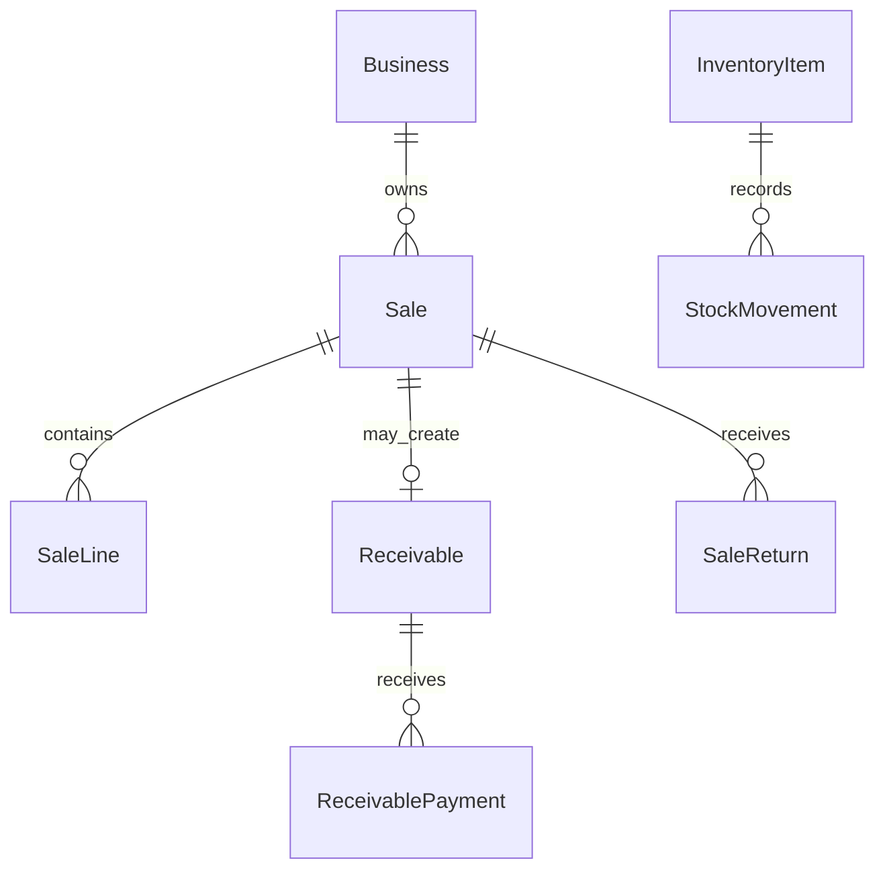
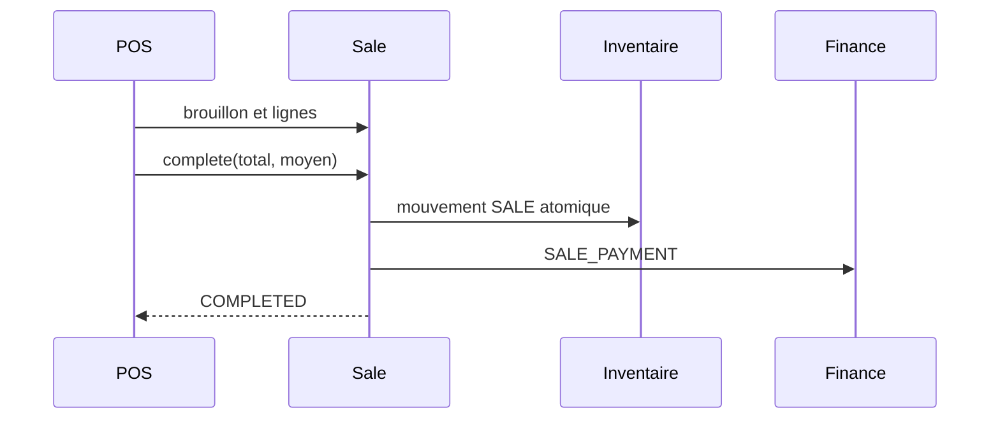

# Architecture commerciale — état audité

## Périmètre

Audit du code Django et Next.js existant, sans modification métier. Sources : `backend/apps/sales/{models,serializers,services,views}.py`, `receivables/{models,services}.py`, `inventory/{models,services,views}.py`, `finance/{models,services}.py`, `catalog/`, `businesses/`, et `src/components/sales/{pos-checkout,sale-manager}.tsx`.

## Architecture et données

`sales.Sale` est l’unique document commercial : `operation_type` distingue `DIRECT_SALE` et `INVOICE`. Une facture n’est donc pas une entité indépendante. Les deux portent des `SaleLine`, avec instantanés de nom, SKU, unité, prix et coût historique. `InventoryItem` détient le solde courant d’un produit simple ou d’une variante; `StockMovement`, `FinancialMovement`, retours et règlements sont append-only.

| Règle | État observé | Source |
|---|---|---|
| Ligne = produit XOR variante | Implémentée | contraintes `SaleLine` |
| PCS entier, KG fractionnable | Implémentée | `LineWrite`, `apply_stock_movement`, retours |
| Prix catalogue hors négociation | Implémentée | `LineWrite.validate` |
| Solde disponible = physique - réservé | Implémentée | `InventoryItem.available_quantity` |

## Caisse POS

Le POS recherche les produits disponibles, crée un brouillon `DIRECT_SALE`, ajoute les lignes puis appelle `complete`. Django refuse une vente directe non entièrement payée, sans ligne ou sans moyen de paiement actif. Une transaction verrouille la vente, écrit une déduction SALE unique (`stock_deducted`) et un `FinancialMovement(SALE_PAYMENT)`.

Paiement intégral et absence de créance : **implémentés**. Double soumission : protections frontend et verrous/indicateur `stock_deducted` backend; **implémenté, à confirmer par test navigateur**. Ticket/reçu imprimable : **absent ou à confirmer**.

## Facturation

Une facture est un `Sale(INVOICE)`. Un brouillon vide est volontairement possible : création du document et ajout progressif des lignes sont séparés par `Sales.post` et `Lines.post`. Cela autorise client, échéance et référence avant le catalogue. La finalisation refuse néanmoins un brouillon sans ligne et exige un nom de client.

La facture finalisée crée une `Receivable`. Paiement nul : créance ouverte; paiement positif : `add_payment`. **Décision métier adoptée :** le stock est déduit au premier règlement réel, jamais à la création ni à la finalisation. Une facture finalisée impayée ne réserve donc pas le stock; un règlement ultérieur peut échouer si le stock a été consommé entre-temps. Ce choix évite une réservation implicite et conserve la déduction et le premier encaissement dans la même transaction.

## Paiements, créances, stocks et retours

- `Receivable.balance = original_amount - paiements - ajustements`; paiements partiels, moyens actifs et idempotence sont contrôlés dans `receivables.services.add_payment`.
- Le premier règlement de facture appelle `deduct_sale_stock`; un règlement ultérieur ne redéduit pas le stock.
- `apply_stock_movement` verrouille l’inventaire, valide unité/disponibilité, modifie le solde et crée l’événement immutable dans une même transaction.
- `create_sale_return` verrouille vente, lignes et créance; empêche excès/doublon, réintègre le stock, réduit la créance puis rembourse au plus les montants encaissés. Retours et remboursements sont idempotents par clé.
- Annulation : uniquement brouillon; aucun impact stock/finance.

## Permissions et sécurité

Les vues résolvent le `Business`, vérifient l’appartenance avec `require_permission`/`has_permission` et filtrent les données par entreprise. Les services revalident les relations. Le frontend masque selon permissions sans être l’autorité. Permissions observées : `SALE_*`, `INVOICE_*`, `SALE_RETURN*`, `INVENTORY_*`, `RECEIVABLE_*` et moyens de paiement d’entreprise actifs.

## Caisse / factures

| Aspect | POS | Facture |
|---|---|---|
| Type | DIRECT_SALE | INVOICE |
| Client | facultatif | exigé à finalisation |
| Paiement | total obligatoire | nul, partiel ou total |
| Créance | non | oui |
| Stock | finalisation | premier règlement réel |
| UI | `pos-checkout.tsx` | `sale-manager.tsx` |

## Invariants, écarts et recommandations

1. **P0, décision adoptée :** une facture impayée ne réserve ni ne déduit le stock; le premier règlement contrôle et déduit toutes les lignes atomiquement.
2. **P0, absent/à confirmer :** ticket POS et facture imprimable.
3. **P1 :** définir expiration/nettoyage des brouillons POS et facture.
4. **P1 :** présenter clairement que la disponibilité peut changer entre facture impayée et premier règlement.

Invariants vérifiés dans le code : pas de finalisation sans ligne; vente directe intégralement payée; mouvements et paiements immuables; relations mono-entreprise; retour limité au vendu et remboursement limité à l’encaissé.

Tests à maintenir : concurrence POS/facture, idempotence paiement/retour, facture impayée puis premier paiement, stock insuffisant, isolation multi-entreprises, PCS/KG et recette navigateur POS/facture/retour. Références : `apps/sales/tests/test_sales.py`, `test_sale_returns*.py`, `apps/inventory/tests/test_inventory*.py`, tests receivables et `tests/pos-checkout.test.ts`.
